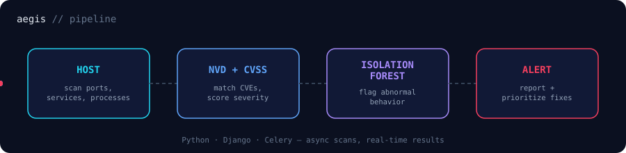

  
  
  
  

## 🛡️ Aegis — what I'm building now
Automated host-based vulnerability identification + behavioral anomaly detection.

## 🧰 Tech Stack

  

## 📁 Projects
| | Project | What it does | Stack |
|---|---|---|---|
| 🛡️ | [**Aegis**](https://github.com/omk44/Aegis) | Vulnerability scanner + anomaly detector using CVSS/NVD data | Python, Django, Celery, scikit-learn |
| 🏥 | [**OptiDoc**](https://github.com/omk44) | High-traffic hospital booking, real-time notifications, doctor portals, admin dashboard | MongoDB, Express, React, Node |
| 💳 | [**LedgerLink**](https://github.com/omk44/LedgerLink) | Credit management with QR identification + automated SMS reminders | — |

## 📊 Stats

  
  

  

## 🐍 Contribution Snake

<i>"Every complex problem has a smarter solution hidden in the logic."</i>

